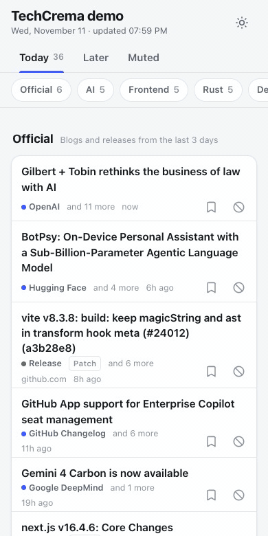
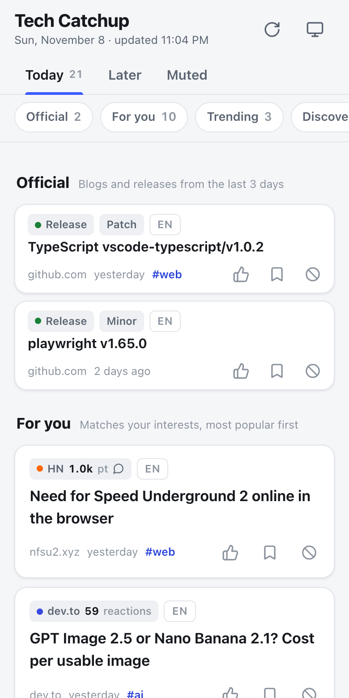
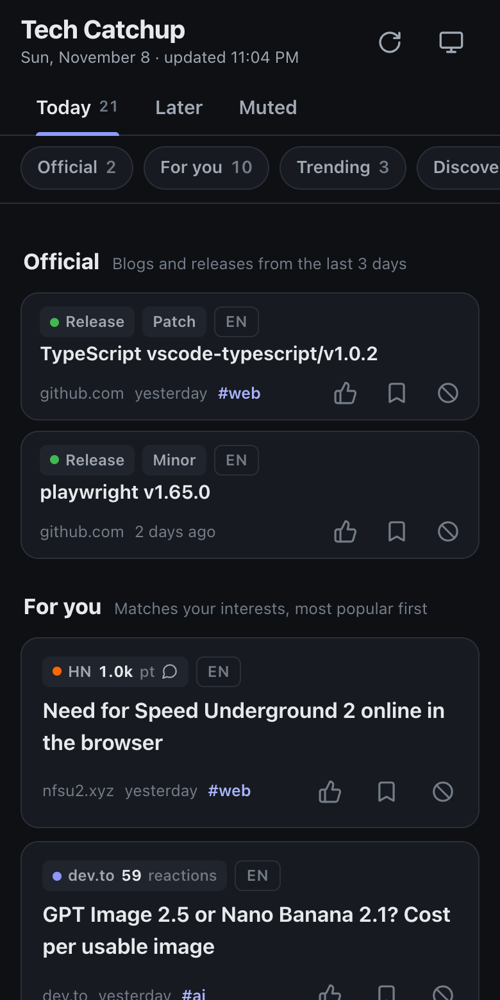

<div align="center">

# ☕ Tech Catchup

**Your own daily tech front page: what's popular across Hacker News, Lobsters, dev.to and more, filtered to what you care about.**

One GitHub Action builds a fast, mobile-friendly page every morning and publishes it to GitHub Pages.
No server, no database, no AI summaries, no account to sign up for.

<a href="https://github.com/kamegoro/tech-catchup/actions/workflows/ci.yml"></a>
<a href="./LICENSE"></a>
<a href="https://github.com/kamegoro/tech-catchup/stargazers"></a>

[Features](#-features) • [Quick start](#-quick-start) • [Configuration](#%EF%B8%8F-configuration) • [Sources](#-sources) • [How ranking works](#-how-ranking-works) • [日本語](docs/README.ja.md)



</div>

---

## 🤔 Why

Keeping up with tech means opening five sites, scrolling past the same stories, and still missing the release you actually needed.
RSS readers show you *everything*; aggregators show you what's popular *for everyone*.

Tech Catchup shows the overlap: **stories that are popular right now _and_ match your interests**, plus a few popular ones from outside your bubble, on a single page you can skim in five minutes on your commute.

## ✨ Features

- 🎯 **Popular × relevant**: every story is scored on how popular it is on its own platform and how well it matches your topics
- ⚖️ **Fair across platforms**: 300 HN points and 50 dev.to reactions mean different things, so each score becomes a percentile within its platform's last 14 days ([how](#-how-ranking-works))
- 🧭 **Five sections a day**: *Official* (blogs & releases you follow), *For you*, *Trending* (top 3% outside your topics), *Discover* (a daily random pick) and *New repos*
- 🔁 **No repeats**: stories you saw yesterday stay hidden unless they keep climbing
- 📱 **Built for phones**: responsive down to 320px, dark mode, add-to-home-screen, light on data (one small JSON file)
- 🔇 **Mute from the page**: tap to hide a site or keyword; the section refills from spare stories
- 🔖 **Read later & likes**: stored in your browser; nothing leaves your device
- 🌐 **English and Japanese**: the UI and default sources follow `language`
- 🪶 **Small and dependency-light**: TypeScript run directly by Node.js, two runtime dependencies, a vanilla JS front end
- 🤝 **Polite by design**: official APIs and RSS only (no HTML scraping), one request at a time per host, a couple of runs a day

<table>
  <tr>
    <td></td>
    <td></td>
  </tr>
</table>

## 🚀 Quick start

You need a GitHub repository for your page. A new, empty one is fine.

**1. Add the workflow.** Create `.github/workflows/tech-catchup.yml` (also in [examples/workflow.yml](examples/workflow.yml)):

```yaml
name: Tech Catchup

on:
  schedule:
    - cron: '0 6 * * *' # every day at 06:00 UTC
  workflow_dispatch: # lets you run it by hand

permissions:
  contents: read
  pages: write
  id-token: write

concurrency:
  group: pages
  cancel-in-progress: false

jobs:
  publish:
    runs-on: ubuntu-latest
    environment:
      name: github-pages
      url: ${{ steps.catchup.outputs.page_url }}
    steps:
      - id: catchup
        uses: kamegoro/tech-catchup@v1
        with:
          language: en
          topics: |
            rust: [rust, cargo]
            databases: [postgres, sqlite, duckdb]
            ai: { weight: 0.8, keywords: [llm, agents, mcp] }
          official: |
            https://blog.rust-lang.org/feed.xml
            rust-lang/rust
```

**2. Turn on Pages.** Go to **Settings → Pages** and set **Source** to **GitHub Actions**.

**3. Run it once.** Go to **Actions → Tech Catchup → Run workflow**. About a minute later your page is live at `https://<you>.github.io/<repo>/`.

From then on it updates on schedule. On your phone, use **Add to Home Screen** and it opens like an app.

> [!NOTE]
> GitHub Pages on the free plan needs a **public** repository, so your topics are visible to anyone who looks.
> The page is marked `noindex` so search engines skip it.

## ⚙️ Configuration

Everything is optional. With no inputs you get an English page of what's popular across the default sources.

| Input | Description | Default |
|---|---|---|
| `language` | `en` or `ja`. Sets the UI language and the default sources | `en` |
| `topics` | What you care about, as YAML (see below) | none |
| `sources` | Comma-separated ids from [Sources](#-sources) | depends on `language` |
| `official` | One per line: an RSS/Atom URL (optionally `Name https://…`), or `owner/repo` for GitHub releases | none |
| `mute-keywords` | Comma-separated keywords to never show | none |
| `mute-domains` | Comma-separated domains to never show (subdomains included) | none |
| `title` | Page title | `Tech Catchup` |
| `timezone` | IANA time zone that decides when "today" starts | `UTC` (`Asia/Tokyo` for `ja`) |
| `config` | Path to a YAML file with the same settings; inputs override it | `tech-catchup.yml` if present |
| `deploy` | `false` builds and uploads the site without deploying | `true` |
| `qiita-token` | Optional Qiita token for a higher rate limit | none |

### Topics

A story goes to **For you** when its title or tags contain any of a topic's keywords.

```yaml
topics: |
  rust: [rust, cargo]                                # short form, weight 1
  frontend: react, vue, svelte                       # comma-separated works too
  ai: { weight: 0.8, keywords: [llm, agents, mcp] }  # lower weight ranks a little lower
```

- ASCII keywords match whole words: `go` does not match `google`
- Other keywords (Japanese, for example) match anywhere in the text
- Matching ignores case

### Using a config file

For longer setups, check out your repository and keep the settings in `tech-catchup.yml` ([example](tech-catchup.yml)):

```yaml
steps:
  - uses: actions/checkout@v7
  - id: catchup
    uses: kamegoro/tech-catchup@v1 # reads ./tech-catchup.yml
```

The file also accepts `layout`, which sets how many stories each section shows:

```yaml
layout:
  for_you: 10            # stories in "For you"
  for_you_min_local: 0   # keep at least this many in your language in "For you"
  trending: 5
  discover: 3
  repos: 3
  official_days: 3       # how far back "Official" looks
  max_source_ratio: 0.4  # no platform takes more than 40% of a section
```

## 📡 Sources

| Source | `sources` id | Popularity signal | Default for |
|---|---|---|---|
| [Hacker News](https://news.ycombinator.com) | `hackernews` | points (front page) | `en`, `ja` |
| [Lobsters](https://lobste.rs) | `lobsters` | score | `en`, `ja` |
| [dev.to](https://dev.to) | `devto` | reactions | `en`, `ja` |
| [Hugging Face Papers](https://huggingface.co/papers) | `huggingface` | upvotes | `en`, `ja` |
| [GitHub](https://github.com) (repos created in the last 7 days) | `github` | stars | `en`, `ja` |
| [Hatena Bookmark](https://b.hatena.ne.jp/hotentry/it) | `hatena` | bookmarks | `ja` |
| [Zenn](https://zenn.dev) | `zenn` | likes | `ja` |
| [Qiita](https://qiita.com) | `qiita` | likes | `ja` |
| Any RSS/Atom feed or GitHub releases | via `official` | none (always shown when new) | |

Every source uses an official API, a public JSON endpoint or RSS. Want another one? See [CONTRIBUTING.md](CONTRIBUTING.md#adding-a-source).

## 🧮 How ranking works

1. **Popularity becomes a percentile.** Each raw score turns into "the share of this platform's stories from the last 14 days that scored lower". A story with 300 points on HN and one with 60 reactions on dev.to can now be compared fairly.
2. **Cross-posting bonus.** A story found on several platforms gets +0.05 per extra platform.
3. **Interest.** The highest weight among the topics it matches (0 if none).
4. **Sections.**
   - **For you:** interest above 0, most popular first.
   - **Trending:** no topic match and popularity ≥ 0.97.
   - **Discover:** no match and popularity between 0.85 and 0.97, shuffled with the date as the seed so it stays the same all day.
5. **Variety.** No single platform fills more than 40% of a section.
6. **Freshness.** Platform stories older than 4 days are dropped. Stories shown on an earlier day stay hidden unless their popularity rises by 0.1 or more; then they come back once, marked *Back again*.

The 14-day score history and the list of shown stories are kept in the Actions cache between runs. Only today's `feed.json` is published.

## 🔒 Privacy & etiquette

- **What gets published:** titles, links and popularity numbers. No article text is copied.
- **What stays on your device:** likes, Read later and mutes live in your browser's `localStorage` and are never sent anywhere.
- **No tracking:** the page loads nothing from third parties, and a strict Content Security Policy blocks inline scripts and outside requests.
- **Gentle fetching:** each run makes one pass over the sources. Requests to the same host go one at a time with a pause (5 seconds for Hatena, per its `robots.txt`). Every request carries a User-Agent naming your repository. Please keep the schedule to a couple of runs a day.
- **Terms of service:** this is meant as a personal reading page. If you build a public service on top of it, check each source's terms first.

## 💻 Running locally

Requires Node.js 24 or later. TypeScript runs directly, with no build step.

```sh
npm install
npm run collect   # fetch and rank using ./tech-catchup.yml (about 20 seconds)
npm run build     # assemble the static site in dist/
npm run preview   # http://localhost:8787
npm run check     # type check + tests
npm run demo -- dist docs   # re-record the README GIF and screenshots (needs Chrome and ffmpeg)
```

## 🤝 Contributing

Issues and pull requests are welcome, especially new sources and UI translations. See [CONTRIBUTING.md](CONTRIBUTING.md).

## 📄 License

[MIT](LICENSE) © kamegoro
