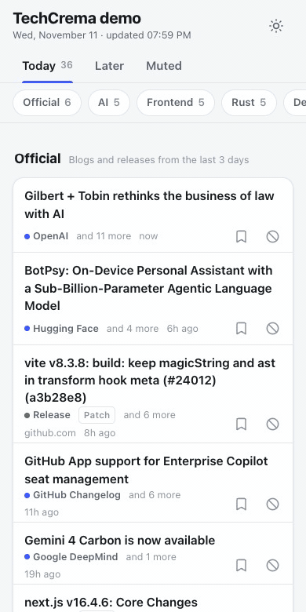

<div align="center">

# ☕ Tech Catchup

**自分専用の「今日の技術ニュース」を毎朝1ページに。各サイトで人気の記事のうち、自分の関心に合うものだけを並べます。**

GitHub Action を1つ置くと、毎日スマホで読みやすいページを作り、GitHub Pages に公開します。
サーバー、データベース、AI要約、アカウント登録はいりません。

[English](../README.md) • [クイックスタート](#-クイックスタート) • [設定](#%EF%B8%8F-設定) • [情報源](#-情報源) • [並べ方](#-並べ方)



</div>

---

## 🤔 なぜ作ったか

技術のキャッチアップは面倒です。いくつものサイトを開いて、同じ記事を何度も見て、それでも本当に必要なリリース情報を見落とします。
RSSリーダーは**すべて**を見せ、ニュースサイトは**みんなにとって**人気のものを見せます。

Tech Catchup が見せるのはその重なりです。**いま人気があり、かつ自分の関心に合う記事**に、関心の外で話題になっているものを少しだけ足して、通勤中に5分で眺められる1ページにまとめます。

## ✨ 特長

- 🎯 **人気 × 関心**: 各記事を「そのサイトでの人気」と「自分の関心との一致」で評価します
- ⚖️ **サイトをまたいで公平**: HNの300ポイントとはてブの300ブクマは同じ重みではありません。そこで各サイトの直近14日の中で上位何%かに直して比べます
- 🧭 **1日5セクション**: 公式(ブログとリリース)、あなた向け、話題(関心外の上位3%)、発見(日替わりの偶然)、新しいリポジトリ
- 🔁 **同じ記事を繰り返さない**: 前日までに見た記事は出しません。人気が伸び続けたものだけ1度戻ってきます
- 📱 **スマホ前提**: 幅320pxまで対応し、ダークモードもあります。ホーム画面に追加でき、通信量は小さなJSON1つです
- 🔇 **画面からミュート**: サイトやキーワードをタップで非表示にでき、空いた枠は予備の記事で埋まります
- 🔖 **あとで読む・いいね**: ブラウザに保存するだけで、外部には送りません
- 🌐 **日本語と英語**: `language` で画面の言語と既定の情報源が切り替わります
- 🤝 **相手サイトに優しい**: 公式API・RSSのみを使います(HTMLのスクレイピングはしません)。同じホストへは1件ずつ取得し、実行は1日数回です

## 🚀 クイックスタート

ページ用の GitHub リポジトリを1つ用意します。新しい空のリポジトリで構いません。

**1. ワークフローを置く。** `.github/workflows/tech-catchup.yml` を作ります。

```yaml
name: Tech Catchup

on:
  schedule:
    - cron: '0 21 * * *' # 毎日 6:00(日本時間)。cron は UTC で書く
  workflow_dispatch:

permissions:
  contents: read
  pages: write
  id-token: write

concurrency:
  group: pages
  cancel-in-progress: false

jobs:
  publish:
    runs-on: ubuntu-latest
    environment:
      name: github-pages
      url: ${{ steps.catchup.outputs.page_url }}
    steps:
      - id: catchup
        uses: kamegoro/tech-catchup@v1
        with:
          language: ja
          topics: |
            typescript: [typescript, deno, bun]
            testing: [playwright, e2e, テスト]
            ai: { weight: 0.8, keywords: [llm, mcp, エージェント] }
          official: |
            Node.js https://nodejs.org/en/feed/blog.xml
            microsoft/TypeScript
```

**2. Pages を有効にする。** Settings → Pages の Source を **GitHub Actions** にします。

**3. 1度だけ手動で実行する。** Actions → Tech Catchup → Run workflow を押します。1分ほどで `https://<ユーザー名>.github.io/<リポジトリ名>/` にページができます。

あとは毎日自動で更新されます。スマホでは「ホーム画面に追加」すると、アプリのように開けます。

> [!NOTE]
> 無料プランの GitHub Pages は**公開リポジトリ**でしか使えません。そのため、関心キーワードも誰でも見られる状態になります。
> ページには `noindex` を付けているので、検索エンジンには載りません。

## ⚙️ 設定

入力はすべて省略できます。入力の一覧と書き方は [README(英語)の Configuration](../README.md#%EF%B8%8F-configuration) にあります。よく使うものは次のとおりです。

| 入力 | 内容 |
|---|---|
| `language` | `en` か `ja`。画面の言語と既定の情報源が決まります |
| `topics` | 関心のあるトピックとキーワード(YAML) |
| `official` | 1行に1つ。RSS/AtomのURL(`名前 URL` の形も可)、または GitHub リリース用の `owner/repo` |
| `mute-keywords` / `mute-domains` | 表示しないキーワードとドメイン(カンマ区切り) |
| `timezone` | 「今日」の区切りに使うタイムゾーン(`ja` の既定は `Asia/Tokyo`) |

キーワードの当たり方:

- 英数字のキーワードは単語単位で照合します(`go` は `google` に当たりません)
- 日本語のキーワードは部分一致です

設定が長くなる場合は、リポジトリに `tech-catchup.yml` を置けます([例](../tech-catchup.yml))。

## 📡 情報源

| 情報源 | id | 人気の指標 | `ja` の既定 |
|---|---|---|---|
| はてなブックマーク(テクノロジー) | `hatena` | ブクマ数 | ✓ |
| Zenn | `zenn` | いいね | ✓ |
| Qiita | `qiita` | いいね | ✓ |
| Hacker News | `hackernews` | points | ✓ |
| Lobsters | `lobsters` | score | ✓ |
| dev.to | `devto` | reactions | ✓ |
| Hugging Face Papers | `huggingface` | upvotes | ✓ |
| GitHub(直近7日に作られたリポジトリ) | `github` | stars | ✓ |

## 🧮 並べ方

1. **人気度**は、各サイトの直近14日の記事の中で上位何%か(パーセンタイル)で表します。複数のサイトに載った記事には、1サイトにつき+0.05の加点があります。
2. **関心度**は、当たったトピックの重みのうち最大の値です。
3. **セクションへの振り分け**は次のとおりです。
   - あなた向け: 関心度が0より大きい記事を人気順に
   - 話題: 関心外で、人気度が0.97以上の記事
   - 発見: 関心外で、人気度が0.85〜0.97の記事から日替わりで
4. 1つのセクションの中で、1つのサイトが占めるのは40%までです。

## 🔒 プライバシーとマナー

- 公開するのは、タイトル・リンク・人気の数字だけです。本文は載せません。
- いいね・あとで読む・ミュートは、ブラウザの `localStorage` に保存するだけです。
- 取得は1回の実行につき1巡だけです。同じホストへの取得は間隔をあけ、はてなは `robots.txt` に合わせて5秒あけます。実行は1日数回にとどめてください。
- 個人の閲覧ページとしての利用を想定しています。不特定多数向けのサービスにする場合は、各サイトの規約を確認してください。

## 🤝 コントリビュート

Issue や Pull Request を歓迎します。情報源の追加、画面の翻訳は特に助かります。[CONTRIBUTING.md](../CONTRIBUTING.md) を見てください(英語)。

## 📄 ライセンス

[MIT](../LICENSE) © kamegoro
